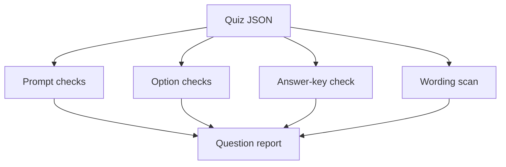

# Quiz Question Quality Auditor

An offline education agent that checks multiple-choice questions for structural completeness and common ambiguity signals before publication.

## How it works

For each question, the agent checks prompt length, minimum option count, duplicate options, whether the answer appears in the options, and configured absolute wording. The report identifies every rule and matched phrase.

## Architecture



## Run and test

```bash
python app.py sample_data.json
python -m unittest -v
```

## Flow and structure

`app.py` processes local question records and produces JSON findings. `sample_data.json` includes one sound structure and one deliberately weak record. `test_app.py` verifies key rules. OpenGAP files are in the root.

## Limitations

The tool cannot validate factual accuracy, pedagogy, fairness, reading level, accessibility, or curriculum alignment. Educators must review every finding and final question.

## Passport

Publish separately, run `opengap validate`, and test one supported adapter export.
